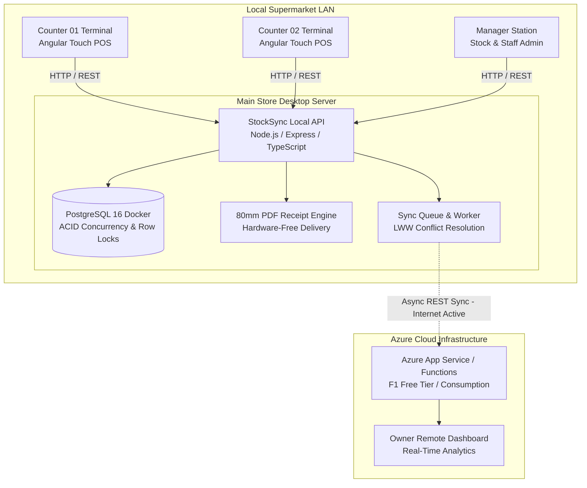

# StockSync: Offline-First Supermarket Management & POS System

[](https://nodejs.org/)
[](https://angular.dev/)
[](https://tailwindcss.com/)
[](https://www.postgresql.org/)
[](https://www.docker.com/)

StockSync is a custom, payment-free supermarket management and accounting system designed for **offline-first reliability at the point of sale**. Operating on a localized Windows desktop client with an embedded PostgreSQL database, the system ensures zero checkout downtime during internet outages. Transactional data and inventory updates are asynchronously synced to an Azure-hosted cloud environment to provide the store owner with real-time remote visibility.

---

## 1. System Architecture Blueprint



---

## 2. Dedicated Top-Level Folder Structure

The repository is structured into self-contained, isolated directories. Each subsystem manages its own configuration, models, dependencies, and environment files without sharing resources:

```
StoreSync/
├── desktop/                  # Native Electron Windows Desktop Wrapper (.exe builder & DPAPI)
│   ├── src/                  # Main process, preload bridge, and native DPAPI service
│   ├── package.json          # Electron & electron-builder packaging config
│   ├── tsconfig.json         # Standalone TypeScript configuration
│   └── README.md
├── frontend/                 # Standalone Angular 22 + Tailwind CSS v4 Touch POS Application
│   ├── src/                  # POS components, services, and local models
│   ├── package.json          # Independent dependencies & build scripts
│   ├── tsconfig.json         # Standalone TypeScript configuration
│   └── README.md
├── backend/                  # Standalone Node.js + TypeScript Local REST API
│   ├── src/                  # Controllers, services, ACID transactions, PDF engine
│   ├── scripts/              # Independent 8-point automated verification suite
│   ├── .env.example          # Template environment configuration
│   ├── package.json          # Independent dependencies & scripts
│   ├── tsconfig.json         # Standalone TypeScript configuration
│   └── README.md
├── database/                 # Standalone PostgreSQL 16 Docker setup
│   ├── docker-compose.yml    # Configured with 'name: stocksync' for Docker Desktop
│   ├── init/                 # 01-init.sql: schema, tables, indexes, and seed accounts
│   ├── .env.example          # Template database credentials
│   └── README.md
├── docs/                     # Architectural documentation, ADRs, and artifacts
│   ├── architecture/         # System overview, schema, sync, RBAC, PDF engine
│   ├── adr/                  # Architecture Decision Records (ADRs 0001–0005)
│   ├── sample-receipt.pdf    # Test-generated 80mm PDF receipt
│   └── setup-guide.md        # Detailed developer onboarding guide
├── .agents/                  # Workspace customizations (simple-review skill)
├── .env.example              # Template root configuration
├── .gitignore                # Comprehensive multi-tier git ignore rules
├── package.json              # Clean root runner scripts (--prefix delegation)
└── README.md                 # Primary system documentation
```

---

## 3. Subsystem Breakdown

### A. Database (`database/`)
* **Container Service**: PostgreSQL 16 Alpine.
* **Docker Desktop Labeling**: Uses `name: stocksync` at the top of `docker-compose.yml` so that Docker Desktop categorizes the container under the clean project group **`stocksync`**.
* **Pre-Seeded Accounts**:
  * **Owner**: `owner` / `Owner@123` (Full system authority, user management, sync controls)
  * **Manager**: `manager` / `Manager@123` (Inventory audit, manual stock adjustments with mandatory reasons)
  * **Salesperson**: `cashier1` / `Cashier@123` (High-speed barcode scanning, cash/UPI checkout, receipts)
* **Commands**:
  ```powershell
  cd database
  docker compose up -d    # Start container 'stocksync-postgres'
  docker compose ps       # Verify status & health
  docker compose down     # Stop container
  ```

### B. Backend API (`backend/`)
* **Technology**: Node.js 24 + Express + TypeScript.
* **Multi-Counter Concurrency**: Applies PostgreSQL `SELECT ... FOR UPDATE` pessimistic locks on deterministically sorted product IDs during checkout, eliminating double-selling across concurrent LAN terminals.
* **Immutable Audit Ledger**: Enforces mandatory reason codes (`RESTOCK`, `DAMAGE`, `WASTAGE`, `RETURN`, `AUDIT_ADJUSTMENT`) and notes for all inventory mutations.
* **Hardware-Free Receipts**: Renders standardized 80mm thermal receipts with GST tax slab breakdowns (0%, 5%, 12%, 18%) using PDFKit.
* **Offline Cloud Sync**: Local `sync_queue` with monotonically increasing sequence IDs and Last-Write-Wins (LWW) conflict resolution for asynchronous Azure sync.
* **Commands**:
  ```powershell
  cd backend
  npm install
  npm run dev              # Starts API on http://localhost:3000
  npm run build            # Compiles TypeScript to dist/
  npm run test:integration # Runs 8-point automated verification suite
  ```

### C. Frontend POS (`frontend/`)
* **Technology**: Angular 22 (Standalone Components) + Tailwind CSS v4.
* **Touch-Friendly Layout**: Large touch targets (`min-h-[56px]`), barcode search with auto-focus, category filter pills, numpad tender modal, and digital PDF receipt viewer.
* **Security & Inactivity Lockout**: Tracks user activity and locks the register screen after 15 minutes of idleness, requiring PIN/password unlock to resume without losing cart items.
* **Commands**:
  ```powershell
  cd frontend
  npm install
  npm start       # Starts POS UI on http://localhost:4200
  npm run build   # Production build
  ```

### D. Desktop Shell (`desktop/`)
* **Technology**: Electron + electron-builder.
* **Single Executable Packaging**: Bundles the Angular POS frontend and Node.js backend into a unified Windows desktop application.
* **Native Windows DPAPI**: Uses Electron's built-in `safeStorage` API to directly invoke Windows DPAPI (`CryptProtectData` and `CryptUnprotectData`) via native C++ OS calls, securing refresh tokens without command-line scripts or antivirus false positives.
* **Commands**:
  ```powershell
  cd desktop
  npm install
  npm run build   # Compiles Electron main & preload
  npm start       # Launches Electron desktop client
  npm run dist    # Builds standalone Windows .exe in desktop/release/
  ```

---

## 4. Verification & Testing

An automated end-to-end test suite (`backend/scripts/test-integration.ts`) runs against the local PostgreSQL container and validates all 8 core system requirements:

```powershell
npm run backend:test
```

```
====================================================
   StockSync End-to-End System Verification Suite   
====================================================

[Test 1] PostgreSQL Container Connection           -> PASS (Connected to stocksync_local)
[Test 2] User Authentication & RBAC                -> PASS (Owner, Manager, Cashier verified)
[Test 3] Product Catalog & Fast Barcode Search     -> PASS (Catalog & scanner lookup verified)
[Test 4] Concurrency-Safe POS Checkout (Row Locks) -> PASS (Stock deducted atomically)
[Test 5] Standardized PDF Receipt Engine           -> PASS (Generated docs/sample-receipt.pdf)
[Test 6] Manual Stock Adjustment with Reason Code  -> PASS (Mandatory audit reason verified)
[Test 7] Offline Sync Queue & Azure Batch Worker   -> PASS (Sync state machine verified)
[Test 8] Staff Management & Instant Revocation     -> PASS (Instant deactivation verified)

====================================================
  ALL INTEGRATION VERIFICATION TESTS PASSED (8/8)  
====================================================
```

---

## 5. Quickstart Commands (Root Level)

For development convenience, root scripts delegate to the respective folders using `--prefix`:

```powershell
# 1. Start the PostgreSQL Docker container (stocksync)
npm run db:up

# 2. Run the full integration test suite
npm run backend:test

# 3. Start the Backend API (http://localhost:3000)
npm run backend:dev

# 4. In a separate terminal, start the Angular Touch POS (http://localhost:4200)
npm run frontend:dev
```

---

## 6. Architecture Documentation Index

* **Blueprints**:
  * [System Overview](docs/architecture/system-overview.md)
  * [Database Schema & ERD](docs/architecture/database-schema.md)
  * [Offline Resilience & Sync Strategy](docs/architecture/offline-sync-strategy.md)
  * [Security & RBAC](docs/architecture/security-and-rbac.md)
  * [Receipt Generation Engine](docs/architecture/receipt-engine.md)
* **Architecture Decision Records (ADRs)**:
  * [ADR 0001: Isolated Top-Level Folders for System Domains](docs/adr/0001-monorepo-structure.md)
  * [ADR 0002: Backend Runtime Selection: Node.js (TypeScript)](docs/adr/0002-backend-runtime-selection.md)
  * [ADR 0003: Local PostgreSQL & Multi-Counter Concurrency](docs/adr/0003-local-database-and-concurrency.md)
  * [ADR 0004: Offline Sync Strategy & Last Write Wins](docs/adr/0004-offline-sync-and-conflict-resolution.md)
  * [ADR 0005: Touch-Friendly POS UI with Angular & Tailwind CSS](docs/adr/0005-pos-touch-ui-and-desktop-wrapper.md)
* **Setup Guide**: [docs/setup-guide.md](docs/setup-guide.md)
