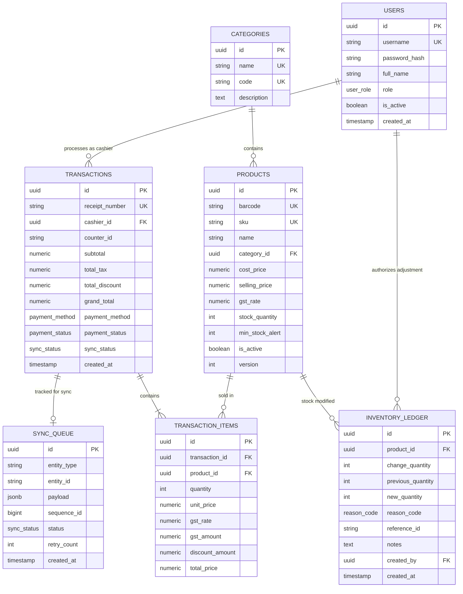

# Database Schema & Concurrency Control

### 1. Entity-Relationship Overview

StockSync's PostgreSQL schema is designed for strict ACID compliance, auditability, and high-concurrency multi-counter operations.



---

### 2. Multi-Counter Concurrency & Row-Level Locking

In a multi-checkout supermarket, two cashiers may scan the last remaining unit of an item at the exact same millisecond. Without strict locking, both transactions could pass, leading to negative inventory and accounting discrepancies.

#### Implementation Strategy

StockSync prevents this through explicit row locking:

```typescript
// 1. Sort item IDs deterministically to avoid cross-counter deadlocks
const sortedItems = [...items].sort((a, b) => a.productId.localeCompare(b.productId));

await withTransaction(async (client) => {
  for (const item of sortedItems) {
    // 2. Lock product row exclusively
    const res = await client.query(
      `SELECT id, stock_quantity, selling_price, gst_rate 
       FROM products 
       WHERE id = $1 
       FOR UPDATE`,
      [item.productId]
    );

    const product = res.rows[0];
    if (product.stock_quantity < item.quantity) {
      throw new Error(`Insufficient stock for ${product.name}`);
    }

    // 3. Deduct stock safely
    await client.query(
      `UPDATE products 
       SET stock_quantity = stock_quantity - $1, version = version + 1 
       WHERE id = $2`,
      [item.quantity, item.productId]
    );

    // 4. Create immutable ledger entry
    await client.query(
      `INSERT INTO inventory_ledger (product_id, change_quantity, previous_quantity, new_quantity, reason_code, ...) 
       VALUES (...)`
    );
  }
});
```

* **Deadlock Prevention**: Sorting product IDs prior to acquisition guarantees that concurrent transactions request locks in identical order.
* **Row-Level Granularity**: While Product A is locked, checkouts scanning Product B run at full wire speed with zero blocking.
