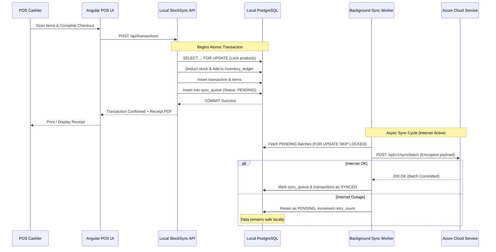

# Offline Resilience & Data Synchronization

### 1. The Offline-First Paradigm

In supermarket environments, checkout stalls cause immediate customer churn and revenue loss. StockSync guarantees that checkout operations never stop due to broadband failures, Azure downtime, or network latency.



---

### 2. Synchronization Queue Design

Every business-critical mutation (Transaction, Manual Stock Adjustment, Return, Price Change) generates an entry in `sync_queue`:

```sql
CREATE TABLE sync_queue (
    id UUID PRIMARY KEY DEFAULT gen_random_uuid(),
    entity_type VARCHAR(50) NOT NULL,
    entity_id VARCHAR(100) NOT NULL,
    payload JSONB NOT NULL,
    sequence_id BIGSERIAL,
    status sync_status NOT NULL DEFAULT 'PENDING',
    retry_count INT NOT NULL DEFAULT 0,
    last_error TEXT,
    created_at TIMESTAMPTZ NOT NULL DEFAULT NOW(),
    synced_at TIMESTAMPTZ
);
```

#### Fields & Purpose
* **`sequence_id`**: A monotonically increasing `BIGSERIAL` integer that preserves the exact chronological order of store operations.
* **`payload`**: Complete self-contained snapshot of the business object, ensuring idempotency on the cloud destination.
* **`status`**: State machine (`PENDING` -> `IN_FLIGHT` -> `SYNCED` or `FAILED`).

---

### 3. Conflict Resolution: Last Write Wins (LWW)

When connectivity is restored after an extended offline period:
1. **Timestamp Authority**: The local store terminal's hardware clock (backed by RTC) provides ISO-8601 UTC timestamps for every transaction.
2. **Sequential Ingestion**: Cloud services process updates ordered by `(created_at, sequence_id)`.
3. **Idempotency**: If a network failure occurs during batch upload acknowledgment, re-transmitting the batch causes zero duplicate sales because cloud storage uses `entity_id` (UUID) as an upsert key.
