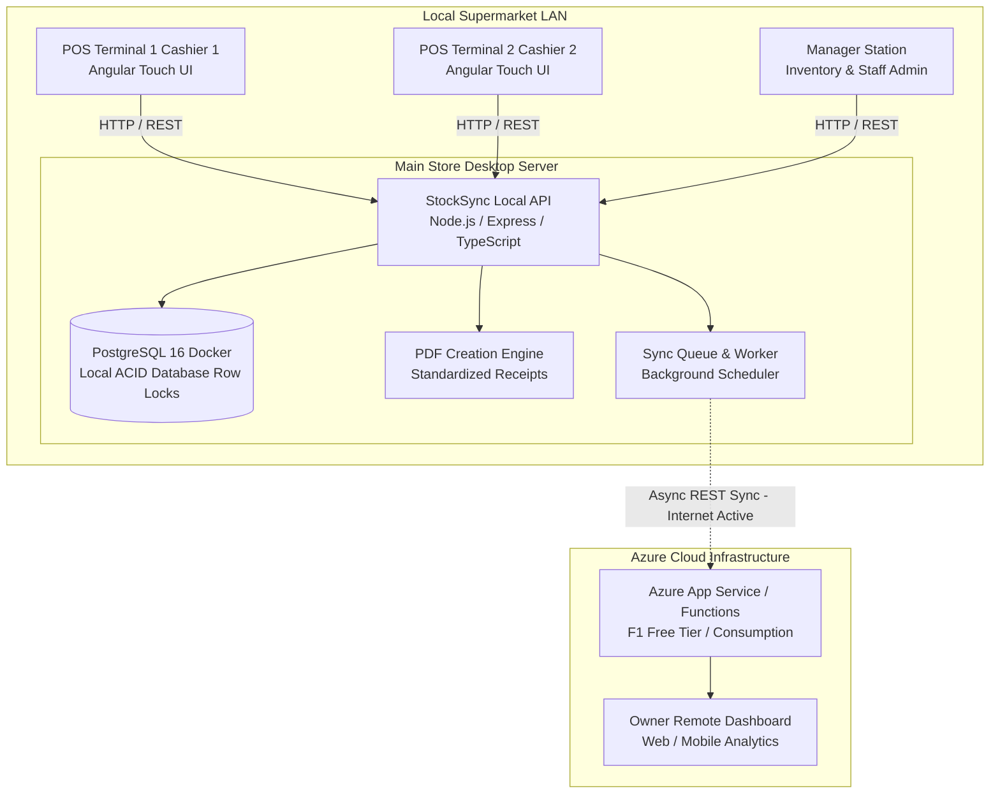

# StockSync: System Architecture Overview

### 1. High-Level Architecture

StockSync is architected as an **offline-first, localized retail management and POS platform**. It provides zero-downtime supermarket checkout operations while enabling asynchronous cloud visibility for store owners.

---

### 2. Core Architecture Tenets

#### A. Offline-First Point of Sale
* **Zero Dependency on WAN Connectivity**: All checkout activities, product searches, barcode scanning, stock deductions, and receipt rendering execute purely against the local LAN server.
* **Embedded/Local PostgreSQL**: Guaranteed sub-50ms latency for scanning and checkout operations.

#### B. Multi-Counter LAN Scalability & Row-Level Locking
* Multiple POS counters in the supermarket connect over the local Gigabit Wi-Fi/Ethernet to the primary store terminal hosting the API and PostgreSQL.
* Simultaneous scanning of the same product at different checkouts is serialized using PostgreSQL **`FOR UPDATE`** row locks. This completely eliminates race conditions, double-selling, and negative stock anomalies.

#### C. Asynchronous Remote Cloud Synchronization
* Transactions and ledger modifications are committed locally first, then enqueued in `sync_queue`.
* A background worker periodically aggregates pending queue entries and transmits batches to the Azure-hosted cloud endpoint.
* In the event of internet outages, sales continue uninterrupted. When internet returns, the background worker replays queued batches using **Last Write Wins (LWW)** conflict resolution.

#### D. Hardware-Free Receipt Delivery
* Rather than requiring proprietary thermal printer ESC/POS driver setups upfront, StockSync uses an embedded PDF generation engine.
* Formatted 80mm receipts with GST breakdowns, itemized details, and counter identifiers are rendered on-the-fly and can be printed to any standard printer or shared digitally.
